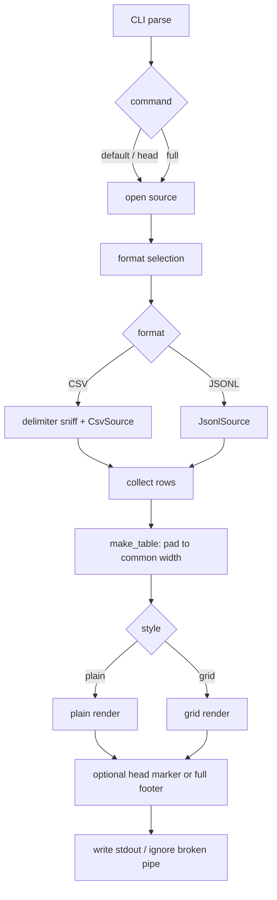

# Architecture

`tablo` is a small Rust binary with a streaming source layer, a typed value
model, a layout layer, and a styling layer. Styling is deliberately separated
from layout so ANSI sequences never participate in width calculations.

## Module map

```text
src/
  main.rs              entry point, command dispatch, stdout writing
  cli.rs               clap argument and subcommand definitions
  table.rs             render-ready Table, Cell, and CellKind types
  formatter.rs         Unicode display width and truncation helpers
  terminal.rs          terminal width and colour enablement
  data/
    types.rs           DataType and Value
    record.rs          Record
    schema.rs          Field and Schema
  source/
    mod.rs             DataSource trait, Input, SourceOptions, source factory
    detect.rs          delimiter sniffing and delimiter parsing
    csv.rs             CSV/TSV adapter and conservative value inference
    jsonl.rs           JSONL adapter, flattening, schema inference, projection
  modes/
    mod.rs             source opening, row collection, table assembly, render
    head.rs            preview mode
    full.rs            full mode
  output/
    mod.rs             renderer modules
    plain.rs           plain layout
    grid.rs            boxed grid layout
    style.rs           Palette, semantic styling, fit/truncate helpers
```

## Flow



## CLI and dispatch

`cli.rs` defines a top-level `Cli` with a positional file, the head-mode options,
and an optional subcommand. `Command::Head` and `Command::Full` duplicate the
relevant options because clap does not make the top-level options global. The
top-level options are used only when no subcommand is present; that path calls
the head mode.

`main.rs` converts the selected options into a `Palette` and calls either
`modes::head::run` or `modes::full::run`. Both return a rendered `String`.
`write_stdout` writes the string once and treats `BrokenPipe` as success.

## Source abstraction

`source::DataSource` is the boundary between input formats and the rest of the
program:

```rust
pub trait DataSource {
    fn schema(&self) -> &Schema;
    fn next_record(&mut self) -> Result<Option<Record>>;
    fn metadata(&self) -> SourceMetadata;
    fn capabilities(&self) -> SourceCapabilities;
}
```

`Input` distinguishes a file path from stdin. `SourceOptions` carries the
explicit format, delimiter, and header flag. `open_source` selects the format,
opens the reader, and constructs the adapter. `SourceMetadata::has_header`
controls whether `head`/`full` display a header row. `SourceCapabilities`
records intended properties such as streaming, projection, known schema, and
known row count; the current adapters report streaming only.

The data model in `data/` is shared by both adapters: `Value` is a typed cell,
`Record` is a row of values, `Schema` is a list of `Field` values, and
`DataType` describes inferred column types. Some model items are not yet
consumed by the renderer, so `data/mod.rs` allows dead code at module level.

## CSV adapter

`CsvSource` configures the `csv` crate with `has_headers(false)` and
`flexible(true)`, so the adapter controls header handling and ragged rows itself.
On construction it reads the first record. With a header, those fields become
the schema names; without one, names are generated as `column_N` and the first
record is kept as pending data.

Every cell passes through `infer_value`. Inference is conservative and
display-preserving: the value is typed only when the canonical text of the typed
value equals the original text. Empty text becomes `Value::Null`; lowercase
`true` / `false` become booleans; canonical signed integers become integers;
canonical finite floats become floats. Everything else, including `00123`,
`1.50`, `1e5`, `inf`, `NaN`, `+1`, `True`, and `-0.0`, stays a string. This
guarantees that typing never changes what the user sees.

Delimiter selection lives in `source/detect.rs`. It reads up to 8192 bytes,
scores each candidate delimiter by parsing the sample with the CSV reader,
and returns a reader that replays the sample followed by the remaining input.
The replay uses `Cursor::chain`, so the whole input is never buffered.

## JSONL adapter

`JsonlSource` reads lines through `BufReader`. Blank lines are skipped. Each
non-blank line must parse as a JSON object; parse errors include the line number
and, where available, the column and a short error category.

For each object, `flatten_into` walks nested objects and emits `(dotted_path,
Value)` pairs. Empty objects become compact `{}` text. Arrays and other nested
shapes become compact JSON text. Numeric conversion keeps `i64` values as
integers, keeps JSON floats as floats, and preserves integers beyond `i64` as
text.

The schema is inferred from the first 1000 non-blank records. `infer_schema`
tracks first appearance order, presence counts, and null presence. Types merge
across the sample: integer plus float becomes float; any other mix becomes text.
A field is nullable if it was null or absent in at least one sampled record.
`JsonlSource` keeps the sampled records in a queue and then continues reading
from the stream. `project` places later records into schema order, filling
missing keys with `Value::Null` and dropping keys that were not in the sample.
`coerce` converts integers, floats, and booleans to text when the column type is
text.

## Rendering pipeline

`modes/mod.rs` provides the shared steps:

- `open` turns CLI arguments into an `Input` plus `SourceOptions` and calls the
  source factory.
- `header_names` reads the schema when `metadata().has_header` is true.
- `collect_rows` reads up to a limit and converts each `Value` into a `Cell`
  with a `CellKind` (`Text`, `Number { negative }`, `Boolean`, or `Null`).
- `make_table` pads headers and rows to the widest row.
- `render` dispatches to `plain::render` or `grid::render`.

The head mode reads one record beyond the requested preview to decide whether to
print `...`, then truncates the table rows. The full mode reads with
`usize::MAX` and appends the row/column footer.

Both renderers compute column widths from `Cell::text` with
`formatter::display_width`, which uses `unicode-width`. They then apply terminal
width constraints, if available, by repeatedly shrinking the widest column down
to a minimum width of three. Headers and cells are fitted with
`output/style::fit_header` and `fit_cell`, which truncate on visible text first,
style the result, and pad using the unstyled width.

## Styling

`output/style.rs` defines `Palette { color, zebra, negative_highlight }`.
`Palette::paint` returns the input unchanged when colour is disabled or the text
is empty. With colour enabled, it uses `owo-colors` styles whose `Display`
implementation emits a local reset at the end of each span. Semantic colours
come from `CellKind`; zebra shading is applied to odd data-row indices and to
their padding and separators.

This split is intentional: layout code never inspects ANSI output, and styling
never changes the visible width of a cell.

## Terminal handling

`terminal.rs` exposes `get_terminal_width` and `color_enabled`.
`color_enabled` requires stdout to be a terminal, no `--no-color` flag, and an
unset or empty `NO_COLOR`. The decision function is unit-tested independently of
the process environment.

## Errors

Adapters and the source factory return `anyhow::Result`. Errors carry context
where useful, such as the file path, the JSONL line number, or the delimiter
value. `main` returns the error to Rust's default handler, which prints it to
stderr and exits with status 1. Broken pipes are handled explicitly in
`write_stdout` and are not reported as errors.

## Adding an input format

1. Implement `DataSource` in a new module under `src/source/`.
2. Add a variant to `source::Format` and a matching CLI value in
   `cli::Format`.
3. Extend `open_source` to construct the adapter and extend extension detection
   in `format_from_extension`.
4. Reuse `modes` unchanged if the adapter can produce `Schema` and `Record`
   values. Add adapter-specific inference in the adapter, not in the renderer.
5. Add fixtures and integration tests under `tests/`.

## Adding a rendering style

1. Add a variant to `cli::Style`.
2. Add a renderer module under `src/output/` with the same
   `render(&Table, &Palette) -> String` shape.
3. Dispatch to it from `modes::render`.
4. Keep width calculation on unstyled `Cell::text` and apply `Palette` only when
   emitting final text.
